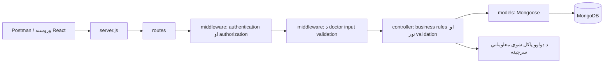
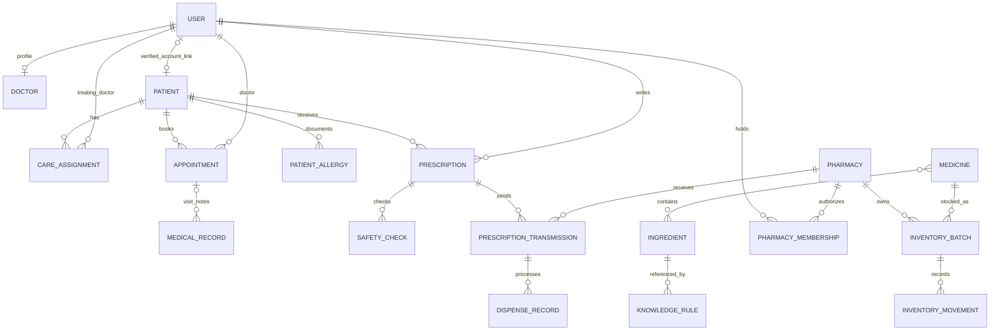
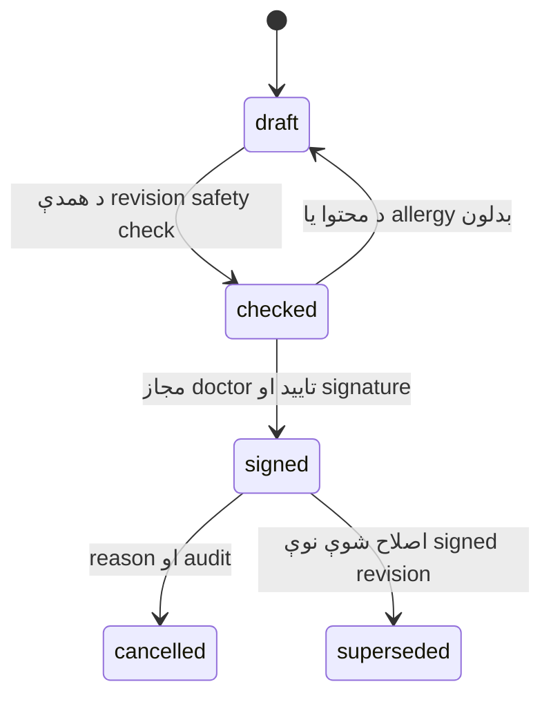

# د Backend معماري او مرحله‌وار پلان

نېټه: ۲۰۲۶-۱۱-۰۲

دا د `PROJECT_REQUIREMENTS.txt` پر بنسټ طرحه ده. «موجود» اوسنی کوډ ښيي؛
«پلان» هغه کار دی چې لا نه دی جوړ شوی. د endpoint طرحه د هغه implementation
نه دی. لومړی ټول Backend او ازموینې بشپړوو، وروسته Frontend ته ځو.
نوي فولډرونه نه جوړوو؛ د اصلي غوښتنو متن هماغسې ساتو.

## ۱. اوسنی حالت

| برخه | موجود | پاتې کار |
| --- | --- | --- |
| Authentication | Signup، signin، bcrypt، Bearer JWT او role middleware | Logout، session revocation، فعال/غیرفعال حساب او audit |
| Users | رولونه او د اډمین له خوا حساب جوړول | لېست، سمون، د صلاحیت ورکولو بشپړ کنټرول او pharmacy membership |
| Patients | ثبت، لېست، لټون، کتنه او PATCH | تایید شوی login link، د درملنې اړیکې، history او allergies |
| Prescriptions | ساده جوړول، لېست، patient filter او کتنه | Draft/check/sign، immutable revisions، cancellation او transmission |
| Doctor Management | linked profile، لېست/search/pagination، partial update، weekly availability او فعال حالت | appointment slot generation؛ د User حساب عمومي امنیت او audit لا جلا پاتې کار دی |
| نور required modules | لا نه دي جوړ شوي | لاندې Roadmap ته مراجعه وکړئ |

فرض: لومړۍ نسخه د یوه روغتون ده او څو داخلي/تایید شوي بهرني درملتونونه
لري. بشپړ multi-hospital tenancy اوس په ساحه کې نشته. Timestamps په UTC
ساتو؛ د روغتون د ښودلو وخت `Asia/Kabul` دی. د ډیمو معلومات خیالي دي.

Signup د کاروونکي د مخکېني تصمیم له مخې هر معتبر role مني، حتی
`hospital_admin`. په دې سند کې یې کوډ نه بدلوو. دا د وروستي امنیتي هدف
پوره کېدل نه دي: د staff د صلاحیت ورکولو کنټرول او د ازموینې role selection
باید د امنیتي پړاو لپاره روښانه جلا شي. تشه ثبت ده؛ د کاروونکي د څرګندې
لارښوونې خلاف به signup په پټه نه بدلېږي.

## ۲. معماري او موجود فولډرونه

| موجود ځای | مسؤولیت | د راتلونکو فایلونو بېلګې |
| --- | --- | --- |
| `server.js` | env، Express، MongoDB، middleware او route mounting | همدا فایل غځوو |
| `models/` | schemas، reference او indexونه | `Doctor.js`، `Appointment.js`، `AuditLog.js` |
| `controller/` | `validator`، business rules، integration او HTTP ځوابونه | `doctorController.js`، `appointmentController.js`، `medicationSafety.js` |
| `routes/` | REST لارې او role middleware | `doctorRoutes.js`، `appointmentRoutes.js` |
| `middleware/` | JWT/session، input validation، relationship checks او errors | `authMiddleware.js`، `doctorValidation.js`؛ وروسته `careAccess.js` او `errorHandler.js` |
| `docs/` | غوښتنې، طرحه او module لارښودونه | همدا سند او د راتلونکو برخو اسناد |
| د Backend root | npm تنظیمات، `.env` او موجود عمومي اسناد | `package.json`، `README.md` او موجود API لارښودونه |

نوي `services`، `config`، `validators`، `scripts` او `tests` فولډرونه نه
جوړوو. شریک منطق په موجود `controller` کې د وړو فنکشنونو/فایلونو په بڼه
ساتو. راتلونکي `*.test.js` فایلونه د اړوند کوډ تر څنګ ځای پر ځای کوو.
د Frontend عملي فولډرونه اوس نه جوړوو؛ د Backend له بشپړېدو وروسته یې
جوړښت د کاروونکي د هماغه پړاو له لارښوونې سره ټاکل کېږي.

## ۳. د MongoDB Collections

`User`، `Patient`، `Prescription` او `Doctor` اوس موجود models دي. د هغوی
لاندې نوي fields او نور models لا پلان دي.

| Model / Collection | مهم fields او اړیکې | قاعده |
| --- | --- | --- |
| `User` / users | name، email، password hash، role؛ وروسته isActive | unique email؛ clinical reference لرونکی حساب غیرفعالېږي |
| `AuthSession` / authsessions | user، refreshTokenHash، expiresAt، revokedAt | expiry په هره اړونده غوښتنه کې هم چک کېږي |
| `Doctor` / doctors | user، specialization، department، registrationNumber، availability، isActive | له doctor `User` سره یو-پر-یو اړیکه |
| `Patient` / patients | موجود demographics او createdBy؛ وروسته user اختیاري | د patient حساب لینک یوازې تر هویت تایید وروسته |
| `CareAssignment` / careassignments | patient، doctor، grantedBy، startsAt، expiresAt، revokedAt، reason | د درملنې فعال او وخت‌محدود صلاحیت |
| `Appointment` / appointments | patient، doctor، startAt، endAt، status، createdBy، rescheduledFrom | د حالت تاریخ او د تکراري booking مخنیوی |
| `MedicalRecord` / medicalrecords | patient، doctor، appointment، diagnosis، observations، vitals، status، correctionOf | finalized ریکارډ د نوې correction له لارې سمېږي |
| `PatientAllergy` / patientallergies | patient، ingredient یا substanceText، kind، reaction، verificationStatus، recordedBy | allergy/sensitivity جلا؛ self-reported معلومات confirmed نه دي |
| `Ingredient` / ingredients | code، name، source، sourceVersion | د سرچینې code unique |
| `Medicine` / medicines | code، name، strength، form، ingredients، source، sourceVersion | د prescription او inventory مشترک catalog |
| `KnowledgeRule` / knowledgerules | kind، ingredient IDs، providerRuleId، severity، evidence، sourceVersion، mode | معتبره سرچینه یا څرګند simulated rule |
| `SafetyCheck` / safetychecks | prescription، revision، contentHash، allergyVersion، sourceVersion، findings، coverage، mode | د یوې مشخصې محتوا check؛ بدلون یې زړوي |
| `Prescription` / prescriptions | patient، doctor، diagnosis، medicines؛ وروسته status، revision، rootPrescription، correctionOf، snapshots، signature | signed clinical content immutable |
| `Pharmacy` / pharmacies | name، type، contact، approvalStatus، approvedBy | یوازې approved او active pharmacy نسخه ترلاسه کوي |
| `PharmacyMembership` / pharmacymemberships | user، pharmacy، approvalStatus، approvedBy، isActive | pharmacist role یوازې عمومي لاسرسی نه ورکوي |
| `PrescriptionTransmission` / prescriptiontransmissions | prescription، revision، pharmacy، sender، status، idempotencyKey، receivedAt | ټاکلي pharmacy ته د signed revision لېږد |
| `DispenseRecord` / dispenserecords | transmission، pharmacist، pharmacy، batch lines، quantities، reason | append-only ثبوت؛ partial dispensing هم ساتي |
| `InventoryBatch` / inventorybatches | pharmacy، medicine، batchNumber، expiresAt، onHand، unit | stock د pharmacy او batch له مخې جلا دی |
| `InventoryMovement` / inventorymovements | batch، delta، type، reference، actor، reason | stock-in، dispense او adjustment تاریخ |
| `Notification` / notifications | recipient، type، entity reference، createdAt، readAt | لومړۍ نسخه in-app؛ په preview کې محدود معلومات |
| `AuditLog` / auditlogs | actor، action، targetType، targetId، outcome، reason، requestId، createdAt | append-only؛ password/token یا بشپړ medical body نه ساتي |
| `HospitalSettings` / hospitalsettings | hospital info، timezone، slot policy، safety source/mode، notification policy | یوازې مجاز admin؛ د حساسو بدلونونو audit |

Dashboard او Reports له مجازو collections څخه aggregation کوي؛ د هر counter
لپاره نوې collection ته اړتیا نشته.

د IDs او indexes پرېکړې:

- `patientId` د `Patient._id` معنا لري، نه د login `User._id`.
- `Prescription.doctor` د doctor حساب `User._id` دی؛ دا موجوده اړیکه ساتو.
  `Doctor.user` هماغه حساب ته reference دی. په APIs کې `doctorUserId` همدا معنا لري.
- `Doctor.user` unique؛ د `Patient.user` غیرخالي لینک هم unique وي.
- د membership لپاره `(user, pharmacy)` او د revision لپاره
  `(rootPrescription, revision)` unique وي.
- patient/date، doctor/date او pharmacy/date د تاریخ indexونه وي.
- د transmission او dispense idempotency key په خپل operation scope کې unique وي.
- لومړۍ نسخه fixed، aligned appointment slots لري. د فعال booking لپاره
  `(doctor, startAt)` unique partial index ټاکل کېږي. له slot بهر وخت او
  overlap نه منل کېږي؛ د slot policy بدلون موجود future booking نه خرابوي.
- Reference یوازې foreign-key تضمین نه دی؛ controller باید د هدف موجودیت،
  role، فعال حالت او اجازه هم چک کړي.

## ۴. Role او relationship permissions

د حساس request ترتیب: JWT/session، فعال حساب، role، patient/pharmacy اړیکه،
validation، عملیات او audit. Role د ټولو ریکارډونو عمومي اجازه نه ده.

| Role | مجاز کارونه | حدود |
| --- | --- | --- |
| `hospital_admin` | users، doctor profiles، pharmacy approval، settings، reports او audit | د خپل روغتون اداري scope؛ clinical read د ثبت شوي audit مقصد له مخې؛ نسخه نه لیکي |
| `receptionist` | demographics، ملاقاتونه او patient موندل | اداري معلومات؛ clinical notes، signing او safety override نه کوي |
| `doctor` | خپل profile، ملاقاتونه، medical records، allergy تایید او prescriptions | خپل لیکلي prescription ریکارډونه؛ د بل clinician تاریخ یوازې د active CareAssignment له مخې |
| `hospital_pharmacist` | دریافت شوې نسخې، inventory او dispensing | یوازې د خپل approved pharmacy membership scope |
| `external_pharmacist` | د تایید شوي بهرني pharmacy نسخې او dispensing | یوازې هماغه recipient pharmacy؛ د روغتون عمومي patient لېست نه ویني |
| `patient` | خپل portal، ملاقاتونه، signed نسخې، self-reports او notifications | یوازې د تایید شوي `Patient.user` لینک له مخې |

اوس doctor په prescription GET کې یوازې خپل لیکلي ریکارډونه ویني. د بل
doctor تاریخ ته د درملنې پر بنسټ لاسرسی راتلونکی کار دی. Patient portal
هم لا نشته، ځکه د login او Patient تایید شوی لینک نه دی جوړ شوی.

CareAssignment admin/receptionist د تایید شوي booking یا درملنې لپاره
ورکوي؛ doctor خپل ځان هر ناروغ ته نه شي assign کولای. شروع، پای او revoke
چک کېږي. د pharmacy approval/membership لغوه کېدل په راتلونکي request کې
اغېز لري، حتی که پخوانی JWT معتبر وي.

## ۵. مهم business workflows

### Sessions او ملاقاتونه

موجود Bearer JWT د Postman لپاره ساتو. په secure-session پړاو کې access
token له AuthSession سره نښلوو؛ logout session revoke کوي. Refresh token
hash په DB کې ساتو او rotation/expiry چک کوو. د راتلونکي browser لپاره
HttpOnly/Secure/SameSite refresh cookie د CSRF او CORS له واضح تګلارې سره
ډیزاین کېږي. غیرفعال حساب protected عملیات نه شي کولای.

Appointment: `scheduled → checked_in → in_progress → completed`.
`cancelled`، `no_show` او `rescheduled` پای حالتونه دي؛ actor/reason ثبتېږي.
Receptionist check-in کوي؛ doctor visit پیل/ختموي؛ patient یوازې د خپل
مجاز booking بدلون غواړي. Reschedule پخوانی ریکارډ ساتي او نوي ته یې تړي.

### Prescription lifecycle

- یوازې مجاز لیکونکی draft بدلوي؛ revision/contentHash او اړوند check تازه کېږي.
- Sign د هماغه contentHash، تازه allergies او ټاکلې source evidence غواړي.
  Client د `safe`، `signed`، signer او approval حالت نه ټاکي.
- Signed snapshot د patient، doctor، medicine/ingredient، diagnosis، instructions،
  safety evidence او وخت معلومات ساتي؛ د catalog وروسته بدلون یې نه بدلوي.
- Canonical content د تنظیم شوي signing mechanism له لارې verify کېږي.
  الگوریتم، keys او re-authentication به په signing پړاو کې مشخص/وازمویل شي؛
  عادي login د حقوقي تصدیق ادعا نه ده.
- Signed clinical fields PATCH نه مني. Correction نوې linked draft/revision
  ده چې جلا check/sign غواړي. Cancellation او superseding دلیل، actor، وخت
  او audit لري؛ محتوا نه حذفوي او recipient pharmacy ته حالت ښکاره کوي.
- پخوانۍ free-text نسخې په پټه signed نه ګڼل کېږي. د migration پر وخت
  legacy unsigned ریکارډونه دي؛ catalog mapping او تازه check غواړي.

### Interaction او allergy checks

Knowledge provider لا نه دی ټاکل شوی. د implementation پر وخت یې رسمي
اسناد، د استعمال حق، ingredient coverage، update version او clinical
validation څېړو. د API موجودیت په یوازې ځان clinical اعتبار نه ثابتوي.

Matching د ingredient IDs پر بنسټ کېږي؛ free-text نوم د معتبر mapping
بدیل نه دی. Unmapped medicine، نامکمل allergy mapping، outdated source او
provider failure د `unknown` یا `not_checked` پایله ورکوي، نه د «خطر نشته».
پایلې `clear`، `warning`، `blocked`، `unknown` یا `not_checked` دي؛ severity،
source/version، coverage او evidence ورسره ساتل کېږي.

له معتبرې source policy پرته safety override نه تعریفوو. مجاز override
د doctor reason/time/audit غواړي. Stale check سره نسخه نه sign کېږي.
Synthetic fixtures باید په API، DB او راتلونکي UI کې `mode: simulated` او
`unsuitable for actual patient care` وښيي. Simulated نتیجه validated نه ده؛
demo transmission یوازې خیالي pharmacy حسابونو ته دی.

### Transmission، dispensing او inventory

Doctor یوازې signed، نه لغوه شوې revision ټاکلي approved/active pharmacy
ته لېږي. Transmission recipient، signature verification، idempotency او
status history لري. حالتونه: `queued → received → accepted` یا `rejected`؛
بیا `partially_dispensed → dispensed`. یوازې recipient membership دا پروسس کوي.

Dispensing نسخه‌يي مقدار، مخکې ورکړل شوی مقدار، batch expiry او stock چک
کوي. Partial dispensing پاتې مقدار ساتي. د stock کمول، DispenseRecord،
InventoryMovement او audit یو atomic عملیات دي. Retry stock بیا نه کموي.
د څو سندونو transactions پړاوونه د MongoDB replica-set چاپېریال او ازموینه
غواړي؛ د standalone عادي څو لیکنو لپاره د atomic transaction ادعا نه کوو.

## ۶. REST API نقشه

Base: `/api`. لاندې `{id}` د حقیقي ID ځای دی. Role د پورته relationship
قواعدو سره یوځای چک کېږي. یوازې لومړی جدول «موجود» دی؛ نور ټول «پلان» دي.

### موجود routes

| Method | Endpoint | اوسنی لاسرسی |
| --- | --- | --- |
| POST | `/auth/signup` | عام؛ ټاکل شوی معتبر role مني |
| POST | `/auth/signin` | عام |
| GET | `/auth/me` | ننوتلی حساب |
| GET | `/auth/admin` | hospital_admin permission check |
| POST | `/auth/users` | hospital_admin |
| POST | `/patients` | hospital_admin، receptionist |
| GET | `/patients` | hospital_admin، receptionist، doctor |
| GET | `/patients/{id}` | hospital_admin، receptionist، doctor |
| PATCH | `/patients/{id}` | hospital_admin، receptionist |
| POST | `/prescriptions` | doctor |
| GET | `/prescriptions` | hospital_admin یا doctor؛ doctor خپل ریکارډونه |
| GET | `/prescriptions/{id}` | hospital_admin یا لیکونکی doctor |
| POST | `/doctors` | hospital_admin؛ موجود doctor حساب ته profile |
| GET | `/doctors` | admin ټول؛ receptionist/doctor فعال directory |
| GET | `/doctors/{doctorUserId}` | admin/خپل doctor بشپړ؛ نورو staff ته active directory fields |
| PATCH | `/doctors/{doctorUserId}` | admin؛ doctor خپل specialization/availability |
| PATCH | `/doctors/{doctorUserId}/availability` | admin یا خپل doctor |

موجود لېستونه pagination لري؛ patient لټون `search` او prescription filter
`patientId` دی. د اوسني `/auth/users` قرارداد ساتو؛ نوې `/users` لارې مدیریت دی.

### Users، appointment slots او appointments — پلان

| Method | Endpoint | موخه / لاسرسی |
| --- | --- | --- |
| POST | `/auth/logout` | خپل session revoke |
| POST | `/auth/refresh` | معتبرې session ته token rotation |
| GET | `/auth/sessions` | خپل sessions |
| POST | `/auth/sessions/{id}/revoke` | خپل ټاکلی session revoke |
| GET | `/users` | admin staff لېست |
| PATCH | `/users/{id}` | admin مجاز profile fields |
| PATCH | `/users/{id}/status` | admin activate/deactivate؛ reason/audit |
| PATCH | `/users/{id}/role` | admin مجاز role change؛ reason/audit |
| GET | `/doctors/{doctorUserId}/slots` | د booking موجود وختونه |
| POST | `/appointments` | admin/receptionist؛ patient خپل verified ریکارډ |
| GET | `/appointments` | staff خپل scope؛ doctor خپل ملاقاتونه |
| GET | `/appointments/{id}` | مجاز staff یا اړوند patient |
| PATCH | `/appointments/{id}/status` | د transition له مخې مجاز role |
| POST | `/appointments/{id}/reschedule` | مجاز scheduler؛ تاریخ ساتل کېږي |
| POST | `/patients/{id}/care-assignments` | admin/receptionist د تایید شوې درملنې لپاره |
| GET | `/patients/{id}/care-assignments` | مجاز staff |
| POST | `/patients/{id}/care-assignments/{assignmentId}/revoke` | مجاز scheduler؛ audit reason |

### Clinical history، medicines او prescriptions — پلان

| Method | Endpoint | موخه / لاسرسی |
| --- | --- | --- |
| POST | `/medical-records` | treating doctor د visit ریکارډ |
| GET | `/patients/{id}/history` | treating doctor؛ admin د مجاز audit مقصد لپاره |
| GET | `/medical-records/{id}` | مجاز doctor/admin؛ وروسته patient خپل finalized ریکارډ |
| PATCH | `/medical-records/{id}` | د خپل draft سمون |
| POST | `/medical-records/{id}/finalize` | لیکونکی doctor |
| POST | `/medical-records/{id}/corrections` | treating doctor؛ linked record او reason |
| GET | `/patients/{id}/allergies` | treating doctor یا linked patient |
| POST | `/patients/{id}/allergies` | treating doctor؛ source/verification |
| PATCH | `/patients/{id}/allergies/{allergyId}` | treating doctor؛ تاریخ او audit |
| GET | `/medicines` | مجاز doctor/pharmacist؛ search/filter/pagination |
| POST | `/medicines` | catalog مجاز admin یا hospital pharmacist |
| PATCH | `/medicines/{id}` | مجاز catalog manager؛ source نه جعل کوي |
| GET | `/ingredients` | مجاز catalog او prescribing کاروونکي |
| GET | `/medication-knowledge/status` | admin/doctor د mode/version/availability لپاره |
| POST | `/medication-knowledge/import` | admin؛ ټاکل شوې مجازه source/schema |
| PATCH | `/prescriptions/{id}` | د خپل unsigned draft سمون |
| POST | `/prescriptions/{id}/check-safety` | لیکونکی doctor؛ server-side check |
| POST | `/prescriptions/{id}/sign` | لیکونکی doctor؛ تازه safety evidence |
| POST | `/prescriptions/{id}/corrections` | مجاز doctor؛ linked draft |
| POST | `/prescriptions/{id}/cancel` | مجاز treating/لیکونکی doctor؛ reason/audit |
| GET | `/prescriptions/{id}/revisions` | د هماغې نسخې د لوستلو مجاز کاروونکی |

### Pharmacy، transmission او inventory — پلان

| Method | Endpoint | موخه / لاسرسی |
| --- | --- | --- |
| POST | `/pharmacies` | admin ثبت؛ external لومړی pending |
| GET | `/pharmacies` | admin ټول؛ doctor ته approved directory |
| PATCH | `/pharmacies/{id}` | admin محدود fields |
| POST | `/pharmacies/{id}/approve` | admin approval/audit |
| POST | `/pharmacies/{id}/suspend` | admin reason/audit |
| POST | `/pharmacies/{id}/memberships` | admin pharmacy membership تاییدوي |
| POST | `/pharmacies/{id}/memberships/{membershipId}/revoke` | admin audit |
| POST | `/prescriptions/{id}/transmissions` | مجاز doctor ټاکلي pharmacy ته لېږي |
| GET | `/prescription-transmissions` | doctor خپل؛ pharmacist د خپل pharmacy |
| GET | `/prescription-transmissions/{id}` | sender، recipient غړی یا مجاز admin |
| POST | `/prescription-transmissions/{id}/acknowledge` | recipient pharmacy |
| POST | `/prescription-transmissions/{id}/accept` | recipient؛ signature/status چک |
| POST | `/prescription-transmissions/{id}/reject` | recipient؛ reason |
| POST | `/prescription-transmissions/{id}/dispense` | recipient pharmacist؛ idempotency/transaction |
| GET | `/prescription-transmissions/{id}/dispenses` | sender/recipient؛ patient خپل portal کې |
| GET | `/pharmacies/{id}/inventory` | هماغه pharmacy غړی یا مجاز admin |
| POST | `/pharmacies/{id}/inventory/batches` | pharmacy مجاز stock manager |
| POST | `/inventory-batches/{id}/adjustments` | مجاز manager؛ delta/reason/audit |
| GET | `/pharmacies/{id}/inventory/movements` | هماغه pharmacy یا admin |

### Portal، dashboard، notifications، reports او settings — پلان

| Method | Endpoint | موخه / لاسرسی |
| --- | --- | --- |
| POST | `/patients/{id}/account-link` | admin/receptionist تر هویت تایید وروسته |
| GET | `/me/patient` | patient خپل verified ریکارډ |
| PATCH | `/me/patient/contact` | patient خپل محدود contact fields |
| GET | `/me/appointments` | patient خپل ملاقاتونه |
| GET | `/me/history` | patient خپل portal ته مجاز finalized معلومات |
| GET | `/me/prescriptions` | patient خپلې signed نسخې او cancellations |
| POST | `/me/allergy-reports` | patient self-report؛ confirmed نه دی |
| GET | `/notifications` | د ننوتلي recipient خپل ریکارډونه |
| PATCH | `/notifications/{id}/read` | یوازې recipient |
| GET | `/dashboard/summary` | د role/relationship له مخې counters |
| GET | `/reports/appointments` | admin یا محدود خپل scope |
| GET | `/reports/prescriptions` | admin؛ doctor خپل؛ pharmacy خپل محدود metrics |
| GET | `/reports/inventory` | admin یا هماغه pharmacy |
| GET | `/reports/safety-checks` | admin/مجاز doctor؛ simulated او validated جلا |
| GET | `/audit-logs` | admin د مجاز audit scope او filters له مخې |
| GET | `/settings/hospital` | admin؛ نورو ته public-safe subset |
| PATCH | `/settings/hospital` | admin validation/audit |
| PATCH | `/me/preferences` | خپل theme/notification preferences، د frontend پړاو اړتیا |

Report export هم د اصلي report اجازې تابع دی، bounded وي او audit لري.
Export د response له لارې ورکول کېږي؛ نوی filesystem فولډر نه جوړوو.

## ۷. ګډ API اصول

- JSON status: `201` create، `200` read/update، `400` validation، `401` auth،
  `403` role، `404` په مجاز scope کې نشته، `409` conflict، `503` لازمه سرچینه نشته.
- Scoped queries د ID د اټکل له لارې د نااړوندو معلوماتو د ښکاره کېدو مخه نیسي.
- Lists: default page size 10، max 50، bounded search/filter او pagination.
- موجود `{patient}` او `{prescription}` ځوابونه ساتو؛ lists جمع نوم او
  `pagination` لري. Errors لږ تر لږه `{message}` لري.
- Allowlist؛ client د author، signer، owner، approval، audit actor یا safety
  result واک نه لري. Business rules په server کې بیا چک کېږي.
- حساس ځوابونه `Cache-Control: no-store` لري. Logs کې secrets او بشپړ medical
  body نه خپروو. مهم mutations له audit ثبوت پرته بریالي نه ګڼل کېږي.
- Status/revision په atomic update کې بیا چک کېږي؛ concurrent conflict `409` دی.
- Clinical records د عادي DELETE له لارې نه ورکېږي؛ deactivate، cancel او
  corrective entry له actor/reason/time سره کاروو.

## ۸. مرحله‌وار Roadmap

هر پړاو Backend دی. پای کې Postman مثالونه، اړین اتومات checks او د بشپړ/پاتې
کار لنډ پښتو بیان ورکول کېږي. ټول ۱۶ required modules په لاندې پړاوونو کې دي.

| پړاو | کار | د منلو معیار |
| --- | --- | --- |
| ۰ | همدا architecture، collections، permissions، API او roadmap | موجود او پلان جلا؛ د ټولو modules پوښښ |
| ۱ — یوه برخه جوړه | Doctor profile، تخصص، department، availability او فعال حالت شته؛ User/session/audit بنسټ پاتې دی | profile، permissions او inactive prescribing اتومات ازمویل شوي؛ بشپړ phase لا نه دی ختم |
| ۲ | Appointments، slots، check-in، reschedule او CareAssignment | duplicate/concurrent slot `409`؛ خپل doctor/patient scope |
| ۳ | Medical Records، History، allergies او verified patient account link | بل patient ته لاسرسی نشته؛ self-report confirmed نه ښودل کېږي |
| ۴ | Medicine Catalog، ingredients او knowledge source integration | source/version/coverage مستند؛ simulated data نښه لري |
| ۵ | Drug Interaction او Allergy Checking | synthetic fixtures او unknown/provider failure سمې پایلې ورکوي |
| ۶ | Prescription draft/check/sign، correction او cancellation | signed content immutable؛ stale check نه sign کېږي؛ trace/audit ساتل کېږي |
| ۷ | Pharmacies، memberships، signed transmission او receipt/verification | approved recipient؛ د بل pharmacy لاسرسی منع؛ cancellation ښکاره |
| ۸ | Inventory او Pharmacy Processing: batches، partial dispensing او transactions | منفي stock نشته؛ expired batch منع؛ retry stock بیا نه کموي |
| ۹ | Patient Portal، Hospital Dashboard، notifications، reports، analytics، audit کتنه او settings | API او counters/exports ټول relationship scope مراعاتوي |
| ۱۰ | پاتې امنیت، migrations، permanent tests او بشپړ Postman اسناد | د Backend checklist بشپړ؛ وروسته Frontend |

د `Doctor Management` لومړۍ برخه په موجود `models/Doctor.js`،
`controller/doctorController.js` او `routes/doctorRoutes.js` کې جوړه ده.
Profile له موجود doctor حساب سره نښلي. د کاري وختونو معنا او د هر رول
fields په `DOCTOR_API.md` کې مستند دي. غیرفعال profile نوې نسخه بندوي؛
بې-profile پخواني doctor حسابونه خپل پخوانی flow لري، تر explicit migration
پورې. Appointment slots لا نه دي جوړ شوي. Session/audit بنسټ هم پاتې دی؛
بشپړ security pass په پای کې هم کېږي. د عام signup role انتخاب معلومه
تشه ده؛ تر حل کېدو مخکې production-ready RBAC نه ادعا کېږي.

## ۹. ازموینې، migration او د Backend بشپړتیا

موجود Postman لارښودونه `PATIENT_API.md`، `PRESCRIPTION_API.md` او
`docs/DOCTOR_API.md` دي. Doctor integration suite په
`controller/doctorController.test.js` کې ساتل شوې او د `npm test` له لارې
چلېږي. خپل موقتي MongoDB کاروي؛ `mongod` یا `MONGOD_BINARY` ورته پکار دی.
د patient/prescription پخواني پراخ checks موقتي وو؛ د نورو modules دایمي
coverage لا پاتې دی. نوي test فایلونه په همدې موجودو code فولډرونو کې راځي.

ازموینې مشخصه جلا test DB او خیالي fixtures کاروي؛ عادي DB نه پاکوي.
د هر پړاو checks باید دا ولري:

- Role او د بل patient/doctor/pharmacy access-denial.
- Missing/expired/revoked sessions او inactive accounts.
- Invalid inputs، IDs، pagination او state transitions.
- Concurrent booking، revision conflict او idempotency.
- Interaction/allergy، unmapped medicine، stale source او provider failure.
- Signed content، correction/cancellation trace او signature verification.
- Partial dispensing، expired batches، insufficient stock او retry.
- د history، report، dashboard، notification او export د scopes برابري.

Migration کې explicit defaults او د unique index تر جوړولو مخکې duplicate
ارزونه کوو. Patient links، doctor profiles او catalog mapping د نوم له مخې
په اتومات ډول نه اټکل کېږي. موجود records په پټه نه ړنګوو یا signed کوو.
د اړینو DB بدلونونو مخکې backup او د اغېز واضح راپور چمتو کېږي؛ migration
کارونه په موجودو فایلونو/فولډرونو کې وي، نه په نوي scripts فولډر کې.

د Backend د بشپړېدو checklist:

- [ ] ټول ۱۶ required modules مجاز Backend endpoints لري.
- [ ] پنځه اصلي موخې په خیالي معلوماتو end-to-end ښودل کېږي.
- [ ] Logout/session، inactive accounts او privilege provisioning حل دي.
- [ ] Patient/doctor/pharmacy scopes، audit او signed immutability ازمویل شوي.
- [ ] Knowledge source، د استعمال حق، coverage او simulation محدودیت مستند دي.
- [ ] Transaction، concurrency او idempotency په مناسب DB چاپېریال کې تېر دي.
- [ ] Permanent automated checks، API اسناد او Postman جریانونه شته.
- [ ] Portal، dashboard، reports او notifications Backend هم بشپړ دی.
- [ ] وروسته، د کاروونکي د ټاکلي جوړښت له مخې Frontend پیلېږي.
